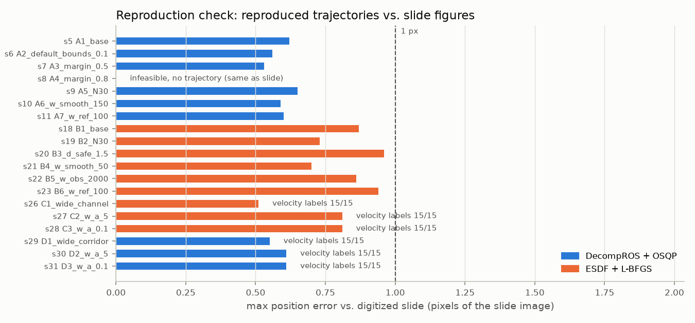
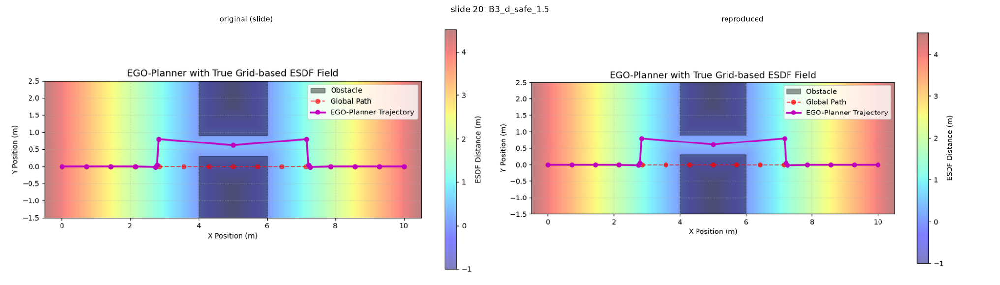
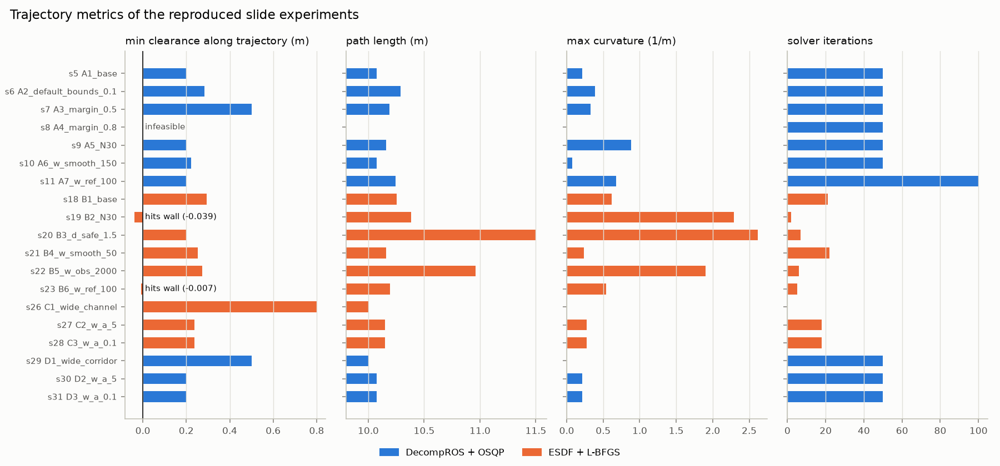
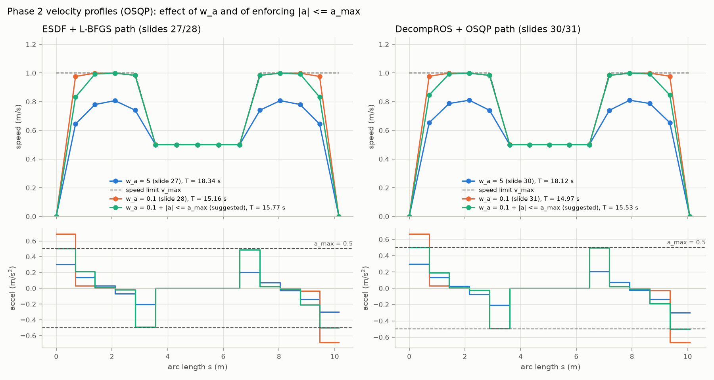
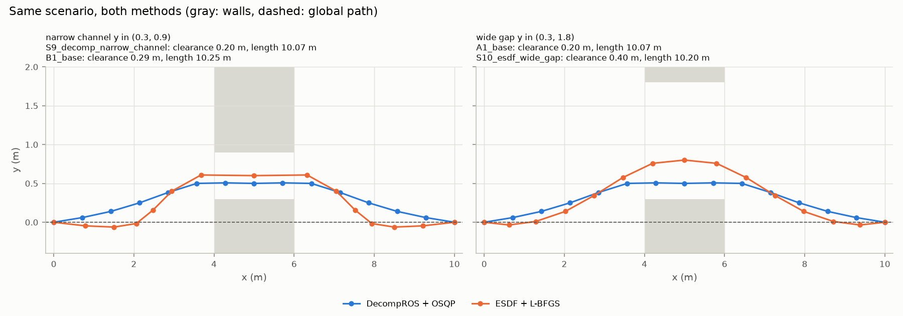
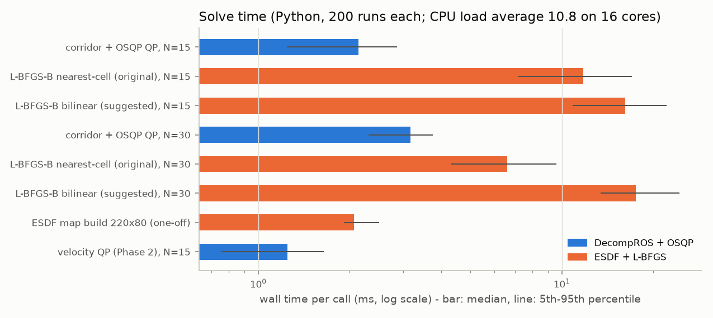
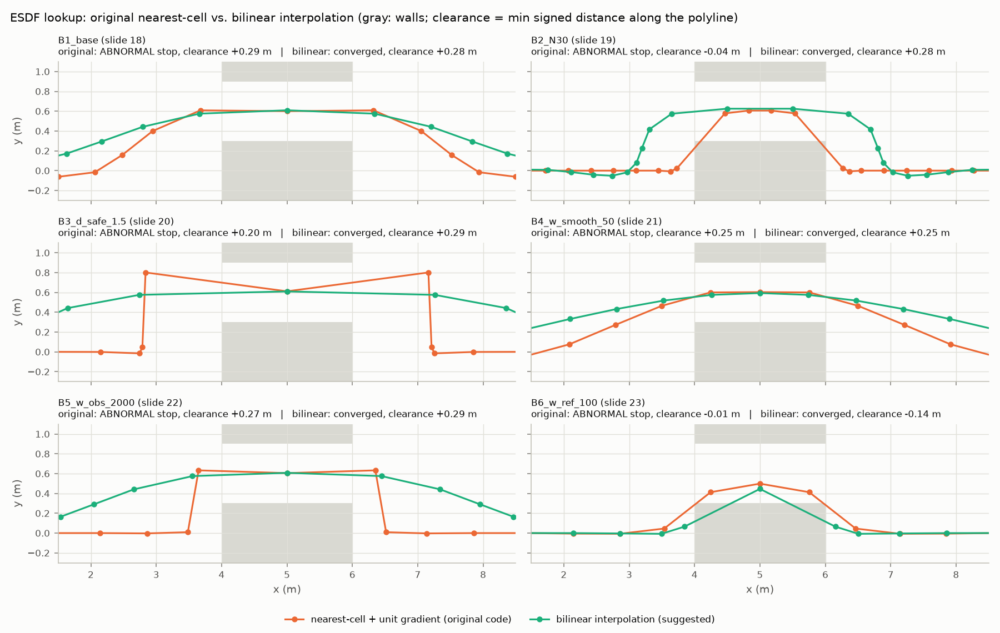

# 避障軌跡規劃：DecompROS + OSQP vs. ESDF + L-BFGS（EGO-Planner）簡報結果重現

依據 `避障軌跡規劃.pptx` 重建兩種局部軌跡規劃器與速度規劃的 Python 程式，重現簡報中全部 19 張結果圖（slide 5–11、18–23、26–31）。
原始程式已遺失；簡報沒寫到、但會影響結果的實作細節，是以「與簡報圖逐點比對」反推出來的（§6）。

測試環境：WSL2、Python 3.12（conda `common_env`）、NumPy 2.5.3、SciPy 1.18.1、OSQP 1.1.3、Matplotlib 3.11.2。只用 CPU，不需要 GPU 或網路。

---

## 1. 重現結果摘要

| 組別 | 簡報頁數 | 內容 | 與簡報圖的誤差 |
|---|---|---|---|
| A | 5–11 | DecompROS-like 安全走廊 + OSQP 軌跡 QP（7 組參數） | 最大 6–8 mm（< 0.7 px）；slide 8 同樣無解 |
| B | 18–23 | ESDF + L-BFGS-B（EGO-Planner）（6 組參數） | 最大 11–15 mm（< 1 px） |
| C | 26–28 | ESDF + L-BFGS 軌跡 + 1D OSQP 速度規劃 | 最大 6–10 mm；速度標籤 45/45 相同 |
| D | 29–31 | DecompROS + OSQP 軌跡 + 1D OSQP 速度規劃 | 最大 6 mm；速度標籤 45/45 相同 |



- **比對方式**：把簡報的結果圖擷取出來，以座標軸刻度校正後，自動找出每個軌跡點的位置（`scripts/00_extract_slides.py`）；速度標籤由放大後的投影片人工判讀。19 張圖的誤差都小於簡報圖的 1 個像素，90 個速度標籤（兩位小數）全部相同。
- **B 組最難重現**：6 組都是 L-BFGS-B 線搜尋失敗（`ABNORMAL`）提早停止的結果，形狀取決於 ESDF 的每個細節。例如 slide 20（d_safe = 1.5）的扭曲軌跡也完全對上：

  

- 19 張原圖與重現圖的並排比對都在 [results/comparison/](results/comparison/)。
- 重跑 `run_all.sh` 時，除了耗時以外的數值每次都完全相同。

---

## 2. 資料夾結構

```
Collision_trajectory_planning/
├── README.md
├── 避障軌跡規劃.pptx              原始簡報
├── run_all.sh                     一鍵重現全部流程（約 1 分鐘）
├── requirements.txt
├── configs/experiments.yaml       所有實驗的參數（簡報頁數 → 參數；建議實驗 S1~S11）
├── planner/                       演算法套件
│   ├── scenarios.py               場景：牆面點雲 / costmap、全域路徑、幾何淨空
│   ├── corridor.py                DecompROS-like 安全走廊生成
│   ├── corridor_qp.py             走廊硬約束 + OSQP 軌跡 QP
│   ├── esdf.py                    網格 ESDF（最近格 / 雙線性查詢）
│   ├── ego_lbfgs.py               EGO-Planner 代價函數 + L-BFGS-B
│   ├── velocity_qp.py             1D OSQP 速度規劃（q = v²）
│   ├── metrics.py                 淨空、路徑長、曲率、行駛時間等指標
│   ├── plotting.py                與簡報同樣式的結果圖 + 指標圖
│   ├── reference.py               與簡報數位化資料比對
│   └── experiments.py             讀設定、執行實驗、輸出（各腳本共用的 CLI）
├── scripts/
│   ├── 00_extract_slides.py       擷取簡報結果圖並數位化 → reference/
│   ├── 01_corridor_qp.py          A 組（slide 5–11）
│   ├── 02_esdf_lbfgs.py           B 組（slide 18–23）
│   ├── 03_esdf_velocity.py        C 組（slide 26–28）
│   ├── 04_corridor_velocity.py    D 組（slide 29–31）
│   ├── 05_suggested.py            S 組：建議實驗（非簡報內容）
│   ├── 06_benchmark.py            求解時間
│   ├── 07_reproduction_check.py   與簡報比對、並排圖
│   ├── 08_make_report.py          metrics.csv、summary.md、比較圖
│   └── tools/search_variants.py   原程式實作細節的反推紀錄（§6）
├── reference/
│   ├── slides/slideNN.png          簡報中的原始結果圖
│   └── slide_reference.json        數位化軌跡點、速度標籤、投影片上的參數文字
├── runs/<實驗 id>/                 每個實驗的輸出
│   ├── trajectory.png              結果圖（與簡報同樣式）
│   ├── velocity_profile.png        速度 / 加速度剖面（C、D、S1、S2）
│   ├── trajectory.csv              每點座標、走廊上下界或 ESDF 值、淨空、速度
│   └── metrics.json                參數、求解器狀態、各項指標
├── results/
│   ├── metrics.csv                 全部實驗的指標
│   ├── summary.md                  結果表格（重現比對、各組指標、建議實驗、耗時）
│   ├── reproduction_check.csv      與簡報的逐張誤差
│   ├── benchmark.csv               求解時間
│   ├── variant_search.md           實作細節反推結果
│   ├── figures/                    比較圖
│   └── comparison/                 原圖與重現圖並排（19 張）
└── logs/                           每個步驟的 log（run_all.log 為全流程）
```

---

## 3. 部署方式

**本機**（套件已裝在 `common_env`）：

```bash
conda activate common_env
cd /home/david/Collision_trajectory_planning
./run_all.sh
```

**新機器**：

```bash
conda create -n traj_plan python=3.12 -y && conda activate traj_plan
pip install -r requirements.txt
./run_all.sh
```

- 只做規劃時可以不裝 `python-pptx`（只有 00 用來讀簡報）。
- OSQP 請用 1.x（測試版本 1.1.3）；0.6.x 的設定名稱與不可行時的回傳值不同，未測試。
- 嵌入到自己的程式時，建議設定 `OPENBLAS_NUM_THREADS=1`（§7-6）。

---

## 4. 使用方式

### 4.1 分步執行

| 步驟 | 指令 | 產出 |
|---|---|---|
| 0 參考資料 | `python scripts/00_extract_slides.py` | `reference/` |
| 1–4 簡報實驗 | `python scripts/01_corridor_qp.py`（02、03、04 同） | `runs/<實驗 id>/` |
| 5 建議實驗 | `python scripts/05_suggested.py` | `runs/S*/` |
| 6 耗時 | `python scripts/06_benchmark.py --repeat 200` | `results/benchmark.csv` |
| 7 比對 | `python scripts/07_reproduction_check.py` | `results/reproduction_check.csv`、`comparison/` |
| 8 報告 | `python scripts/08_make_report.py` | `results/metrics.csv`、`summary.md`、`figures/` |

實驗 id 與簡報頁數的對應在 `configs/experiments.yaml`，例如 slide 20 = `B3_d_safe_1.5`。

### 4.2 修改參數

```bash
# 只跑一個實驗
python scripts/02_esdf_lbfgs.py --exp B3_d_safe_1.5

# 臨時覆寫參數（區塊.參數=值，可一次給多個），輸出到 runs/B1_base__d_safe=0.4_lookup=bilinear/
python scripts/02_esdf_lbfgs.py --exp B1_base --set ego.d_safe=0.4 map.lookup=bilinear

# 指定輸出名稱
python scripts/04_corridor_velocity.py --exp D2_w_a_5 --set velocity.enforce_a_max=true --name D2_amax
```

有 `--set` 時會自動換一個輸出名稱，不會覆蓋簡報實驗的結果。常用參數：

| 區塊 | 參數 | 說明 |
|---|---|---|
| （頂層） | `N` | 控制點數 |
| `corridor` | `margin`、`default_bounds`、`search_half_width` | 安全邊距、附近沒有障礙物時的上下界、找障礙物的 x 視窗半寬 |
| `qp` | `w_smooth`、`w_ref`、`smooth_p_scale` | 軌跡 QP 權重；`smooth_p_scale` 見 §6-1 |
| `ego` | `d_safe`、`w_smooth`、`w_obs`、`w_ref` | EGO 代價函數 |
| `map` | `resolution`、`lookup` | ESDF 解析度；`nearest`（原程式）或 `bilinear` |
| `walls` | `bottom`、`top`（A/D）、`channel`（B/C） | 牆的位置 |
| `velocity` | `v_target`、`a_lat_max`、`w_v`、`w_a`、`enforce_a_max` 等 | 速度規劃 |
| `osqp`、`lbfgs` | 求解器設定 | 例如 `osqp.polishing=true`、`lbfgs.maxiter=100` |

要長期保留的新實驗，在 `configs/experiments.yaml` 的 `experiments:` 加一行，例如
`- {id: B7_d_safe_0.4, group: B, desc: "d_safe 0.4", set: {ego.d_safe: 0.4}}`，再用 `--exp B7_d_safe_0.4` 執行。

### 4.3 在 Python 中使用

```python
import sys; sys.path.insert(0, "/home/david/Collision_trajectory_planning")
from planner.scenarios import global_path, WallPointCloud, WallChannel
from planner.corridor import generate_corridor
from planner.corridor_qp import solve_trajectory_qp
from planner.esdf import GridESDF
from planner.ego_lbfgs import optimize_trajectory
from planner.velocity_qp import optimize_velocity_profile_corridor

ref = global_path(15)                                    # (0,0) -> (10,0) 的直線

# 方法 A：走廊 + OSQP，再做速度規劃
obs = WallPointCloud(bottom=(-1.5, 0.3), top=(1.8, 2.5)).points()
boxes = generate_corridor(ref, obs, margin=0.2)          # 每列 [x, y_min, y_max]
qp = solve_trajectory_qp(ref, boxes, w_smooth=15.0, w_ref=1.0)
vel = optimize_velocity_profile_corridor(qp.Q, boxes, w_a=5.0)
print(qp.status, vel.v.round(2), vel.travel_time)

# 方法 B：ESDF + L-BFGS-B
esdf = GridESDF(WallChannel(channel=(0.3, 0.9)), lookup="nearest")
ego = optimize_trajectory(ref, esdf, d_safe=0.6, w_smooth=5.0, w_obs=200.0, w_ref=0.5)
print(ego.message, ego.Q)
```

換成自己的障礙物：方法 A 直接把點雲 `(M, 2)` 傳給 `generate_corridor`；方法 B 可繼承 `GridESDF`，改寫 `_add_wall_obstacles()` 填入自己的 costmap。

---

## 5. 各指標結果說明

指標定義：

- **淨空**：到牆面的有號距離，負值代表撞牆。「點淨空」只看控制點；「折線淨空」每 1 cm 檢查相鄰點之間的線段（簡報圖就是用折線連接各點）。
- **最大偏離**：與全域路徑對應點的最大距離。**曲率**：三點外接圓的離散曲率（1/m）。
- 完整數字見 [results/summary.md](results/summary.md) 與 `results/metrics.csv`。



### 5.1 A 組：DecompROS + OSQP（slide 5–11）

| 實驗（slide） | 結果 | 折線淨空 | 路徑長 | 最大曲率 |
|---|---|---|---|---|
| [A1 基準](runs/A1_base/trajectory.png)（5） | 通道內貼著走廊下界 y = 0.5 | 0.200 m | 10.075 m | 0.21 |
| [A2 預設走廊 ±0.1](runs/A2_default_bounds_0.1/trajectory.png)（6） | 障礙物前後被限制在 ±0.1，進通道前急轉並往下超調到 −0.1 | 0.284 | 10.291 | 0.39 |
| [A3 margin 0.5](runs/A3_margin_0.5/trajectory.png)（7） | 走廊為 [0.8, 1.3]，貼著 0.8 | 0.500 | 10.189 | 0.33 |
| [A4 margin 0.8](runs/A4_margin_0.8/trajectory.png)（8） | 走廊 [1.1, 1.0] 為空集合，OSQP 回報 primal infeasible | – | – | – |
| [A5 N = 30](runs/A5_N30/trajectory.png)（9） | 一樣貼著下界，點變密後轉折更集中 | 0.200 | 10.159 | 0.88 |
| [A6 w_smooth 150](runs/A6_w_smooth_150/trajectory.png)（10） | 最平滑，中段拱起離開下界 | 0.222 | 10.073 | 0.07 |
| [A7 w_ref 100](runs/A7_w_ref_100/trajectory.png)（11） | 盡量貼著全域路徑，只在通道處跳上去 | 0.199 | 10.242 | 0.68 |

- 硬約束的行為很一致：走廊不為空時，淨空就等於 margin（0.2 / 0.5 m），軌跡停在離參考路徑最近的走廊邊界上；走廊為空時直接無解（A4），不會輸出危險軌跡。這就是簡報 slide 3 提到的「100% 幾何安全」與「無解風險」。
- A7 的 0.199 m 比 margin 少約 1 mm（走廊下界最多被違反 1.65 mm），來自 OSQP 預設精度（eps = 1e-3），開 `osqp.polishing=true` 後為 0.200 m（§7-5）。

### 5.2 B 組：ESDF + L-BFGS（slide 18–23）

| 實驗（slide） | 結果 | 點 / 折線淨空 | 路徑長 | 最大曲率 |
|---|---|---|---|---|
| [B1 基準](runs/B1_base/trajectory.png)（18） | 穿過通道中心 y ≈ 0.6；原本在牆內的點被往左右推出 | 0.300 / 0.294 m | 10.253 m | 0.62 |
| [B2 N = 30](runs/B2_N30/trajectory.png)（19） | 只迭代 2 次；控制點都在牆外，但線段切過牆角 | 0.271 / **−0.039** | 10.384 | 2.29 |
| [B3 d_safe 1.5](runs/B3_d_safe_1.5/trajectory.png)（20） | d_safe 遠大於通道半寬 0.3，整條通道都被懲罰，停在扭曲的局部解 | 0.289 / 0.200 | 11.496 | 2.62 |
| [B4 w_smooth 50](runs/B4_w_smooth_50/trajectory.png)（21） | 平滑，轉折分散到兩側 | 0.297 / 0.252 | 10.158 | 0.23 |
| [B5 w_obs 2000](runs/B5_w_obs_2000/trajectory.png)（22） | 排斥力過強，其他點留在 y = 0，通道兩端直上直下 | 0.295 / 0.274 | 10.963 | 1.90 |
| [B6 w_ref 100](runs/B6_w_ref_100/trajectory.png)（23） | 參考拉力壓過排斥力，中間只到 0.5，兩側點離下牆只剩 0.11 m | 0.112 / **−0.007** | 10.192 | 0.54 |

- 6 組都以 `ABNORMAL`（線搜尋失敗）結束，原程式也是如此（§6-5）：ESDF 用最近格查詢，代價函數是分段常數、和梯度不一致，線搜尋找不到可接受的步長就停止。B2 只迭代 2 次、B3 的跳躍都是這個原因。
- 軟約束沒有安全保證：B2、B6 的控制點都在牆外，但點與點的連線撞到牆角。

### 5.3 C、D 組：速度規劃（slide 26–31）

| 實驗（slide） | 限速點 | 行駛時間 | 最高速 | 最大 \|a\| |
|---|---|---|---|---|
| [C1](runs/C1_wide_channel/velocity_profile.png)（26）、[D1](runs/D1_wide_corridor/velocity_profile.png)（29） | 無（C1 離牆 0.8 m、D1 走廊寬 2.3 m，直線即可） | 13.57 s | 0.99 m/s | 0.33 m/s² |
| [C2 w_a 5](runs/C2_w_a_5/velocity_profile.png)（27） | 中間 5 點離牆 < 0.6 m，限 0.5 m/s | 18.34 s | 0.81 | 0.30 |
| [C3 w_a 0.1](runs/C3_w_a_0.1/velocity_profile.png)（28） | 同上 | 15.16 s | 1.00 | **0.69** |
| [D2 w_a 5](runs/D2_w_a_5/velocity_profile.png)（30） | 中間 5 點走廊寬 1.1 m < 2 m，限 0.5 m/s | 18.12 s | 0.81 | 0.30 |
| [D3 w_a 0.1](runs/D3_w_a_0.1/velocity_profile.png)（31） | 同上 | 14.97 s | 1.00 | **0.67** |



- w_a 從 5 降到 0.1，速度幾乎直接貼到上限，行駛時間少約 3.2 s，但起步與停車的加速度達 0.67–0.69 m/s²，超過 a_max = 0.5。原程式雖然傳入 a_max，卻沒有加這個約束（加上後見 §7-4）。
- 曲率限速 √(a_lat_max / κ) 在這些軌跡上都大於 1 m/s（最大曲率 0.27），真正起作用的只有環境限速；最大側向加速度 0.19 m/s²。
- C2 與 D2 的限速點都是中間 5 點、弧長也相近，所以速度剖面幾乎一樣（行駛時間差 0.2 s）。

### 5.4 同場景對照（建議實驗 S9、S10）

簡報中兩種方法測的是不同的牆：A/D 的通道寬 1.5 m（y 0.3–1.8），B/C 只有 0.6 m（y 0.3–0.9），指標不能直接相比。S9、S10 把場景交換：



| 場景 | DecompROS + OSQP | ESDF + L-BFGS |
|---|---|---|
| 窄通道 0.3–0.9 | 淨空 0.200 m、路徑 10.075 m（S9） | 淨空 0.294 m、路徑 10.253 m（B1） |
| 寬通道 0.3–1.8 | 淨空 0.200 m、路徑 10.075 m（A1） | 淨空 0.397 m、路徑 10.204 m（S10） |

DecompROS + QP 的軌跡由走廊邊界決定：淨空固定等於 margin、路徑最短，而且兩個場景的軌跡相同（上牆離得夠遠，只有下界在作用）。ESDF + L-BFGS 會把軌跡推到代價平衡的位置、離牆較遠，路徑長 1–2%，但沒有保證。

### 5.5 求解時間



| 案例（200 次的中位數） | N = 15 | N = 30 |
|---|---|---|
| 走廊生成 + OSQP 軌跡 QP | 2.14 ms（OSQP 本身 0.10 ms） | 3.18 ms（0.19 ms） |
| L-BFGS-B，最近格查詢（原程式） | 11.75 ms（21 次迭代） | 6.61 ms（2 次迭代就停止） |
| L-BFGS-B，雙線性查詢（建議） | 16.17 ms | 17.54 ms |
| ESDF 建圖 220 × 80（一次性） | 2.07 ms | |
| 速度 QP | 1.25 ms（OSQP 本身 0.10 ms） | |

- 這組數字（`results/benchmark.csv`）量測時，另一個工作階段正用 12 個行程佔用 CPU（load average 10.8 / 16 核）。前一次在 CPU 空閒時量到的約為這裡的 0.4 倍：走廊 + OSQP 0.87 ms、L-BFGS-B 4.65 ms、速度 QP 0.49 ms（N = 15）。兩種方法的相對快慢不受影響。
- 時間大多花在 Python 端組矩陣與小陣列運算，OSQP 求解本身只有 0.1–0.2 ms。簡報 slide 2 引用的 1–4 ms、1–5 ms 是 C++ 函式庫的數量級；Python 版的 OSQP 路徑也在這個範圍，L-BFGS-B 則是它的 2–8 倍（每次函數評估都在 Python 端查 ESDF、算梯度）。

---

## 6. 原程式細節的反推（重現說明）

簡報沒有寫到、但會改變結果的地方，都以「與簡報圖的誤差」比較候選做法後決定，過程可用 `scripts/tools/search_variants.py` 重跑，結果在 [results/variant_search.md](results/variant_search.md)。

1. **走廊 QP 的平滑項係數**：slide 25 寫 P += 2·w_smooth·M，但只有 P += w_smooth·M（等效成本 ½·w_smooth·Σ‖Δ²Q‖²）才對得上簡報（最大誤差 8 mm，對比 65 mm）。`qp.smooth_p_scale` 預設 1.0 為原程式行為，設 2.0 即為 slide 25 的公式。
2. **走廊生成**：每個路徑點只看 x 方向 ±0.5 m 內的障礙物點（N = 15 時 x = 3.57 的點有納入，N = 30 時 x = 3.45 的點沒有，所以視窗介於 0.43–0.55 m），再以 y 方向最大空隙分出上下牆。走廊寫成 `A_i Q_i ≤ b_i`（l = −∞）的半平面，因此 margin 0.8 時 OSQP 會回報 primal infeasible，而不是在 setup 階段報錯，與 slide 8 一致。
3. **ESDF 格點數**：`nx = int(11 / 0.05) = 220`、`ny = 80`（沒有 +1），並用 `np.linspace` 判斷每格是否為障礙物。依據：簡報 colorbar 範圍是 −1.00 ~ 4.51；220 × 80 時牆寬 40 格、最深處為 −1.00，221 × 81 則是 −1.05，而且只有 220 × 80 的通道中心剛好落在 y = 0.6。
4. **ESDF 查詢**：`ix = int((x − x_min) / res)` 取所在格的距離，梯度為 `np.gradient` 後**單位化**的方向。12 種組合中只有這一種讓 6 張圖都在 15 mm 以內，其餘最好的也差 145 mm。
5. **L-BFGS-B**：SciPy 預設參數（maxcor 10、maxiter 15000），以全域路徑為初始值，起終點以梯度歸零固定。6 組都是線搜尋失敗結束；SciPy 1.15 之後這個訊息只顯示 `ABNORMAL: `（舊版為 `ABNORMAL_TERMINATION_IN_LNSRCH`）。
6. **C 組（slide 26–28）的 EGO 權重**：簡報沒有列出。300 組候選中，d_safe 0.6、w_smooth 50、w_obs 200、w_ref 5 與 slide 27 的軌跡誤差最小（10 mm），slide 27、28 的 30 個速度標籤也全部相同。另有幾組也能對上全部標籤，但軌跡誤差較大，所以這組權重屬於推定值。
7. **速度規劃**：與 slide 25 的矩陣構建完全一致（P 的係數為 2·w_v、2·w_a），但原程式沒有加 |a| ≤ a_max。曲率的算法無法從簡報判斷（曲率限速都沒有起作用），這裡用三點外接圓。
8. **繪圖**：slide 26 原圖只畫了上牆的遮罩（下牆只看得到 ESDF 顏色），重現圖兩道牆都畫；slide 8 的重現圖另外加了紅框註明不可行。OSQP 1.x 不可行時 `res.x` 不是 NaN（而是 2.1e9），程式改以 `status` 判斷。

---

## 7. 建議

1. **ESDF 改用連續內插**（S3–S8，`map.lookup=bilinear`）：6 組都正常收斂，B2 的撞角（折線淨空 −0.039 → +0.275 m）、B3 的扭曲軌跡（路徑 11.50 → 10.15 m）、B5 的直角轉折（10.96 → 10.11 m）都消失；耗時多 1.4–2.7 倍（§5.5）。

   

2. **碰撞檢查要沿著整條軌跡**：B2、B6 的控制點都在牆外，但連線撞到牆角。B6 改雙線性並把 w_obs 提高到 2000（S11）後，控制點淨空有 0.275 m，線段仍切到牆角 2 mm，因為代價函數只懲罰控制點。建議在代價函數加入線段中點或 B-spline 取樣點，或在輸出前沿線檢查 ESDF。
3. **軟約束參數要設上限**：d_safe 應小於通道半寬（B3 以 1.5 m 對 0.3 m 半寬的通道就失敗）；w_ref 不能遠大於 w_obs（B6）。實務上可在 EGO 輸出後做一次硬性淨空檢查，不通過就改用 DecompROS + OSQP 或重新規劃。
4. **速度 QP 加入 |a| ≤ a_max**（S1、S2，`velocity.enforce_a_max=true`）：最大加速度壓在 0.50 m/s²，行駛時間只多 0.6 s（D3 14.97 → 15.53 s、C3 15.16 → 15.77 s）。
5. **OSQP 開啟 polishing**：預設精度下硬約束會差 1–2 mm（A7），`osqp.polishing=true` 可精確滿足，耗時幾乎不變。重現簡報時維持預設值。
6. **BLAS 設成單執行緒**：這些問題只有幾十維，OpenBLAS 多執行緒反而拖慢；測試期間 CPU 忙碌時，L-BFGS-B 單次從 88 ms 降到 12 ms，結果不變。`run_all.sh` 已設定 `OPENBLAS_NUM_THREADS=1`。
7. **走廊的形狀**：目前的走廊是「每個路徑點一段 y 區間」，只約束控制點。真正的 DecompROS 是沿路徑線段膨脹出凸多邊形，能保證整段線段安全，也能處理斜向通道。
8. **名稱**：原版 EGO-Planner（Zhou et al., 2021）其實不使用 ESDF，而是用碰撞段的 {p, v} 對把控制點推出障礙物；簡報這種 ESDF 梯度做法比較接近 Fast-Planner。前面第 1、2 點的問題，正是 {p, v} 做法想解決的。

---

## 8. 常見訊息

- `ABNORMAL: `（B、C 組）：L-BFGS-B 線搜尋失敗提早結束。這是原程式的行為，重現時保留；改用 `map.lookup=bilinear` 就會正常收斂。
- `primal infeasible`（A4）：走廊上下界交叉，屬於預期結果。
- `CONVERGENCE: NORM OF PROJECTED GRADIENT <= PGTOL`（C1）：直線已經是最佳解，迭代 0 次。
- 每次執行的耗時數字會略有不同；軌跡、指標、速度等其他數值每次都相同。
